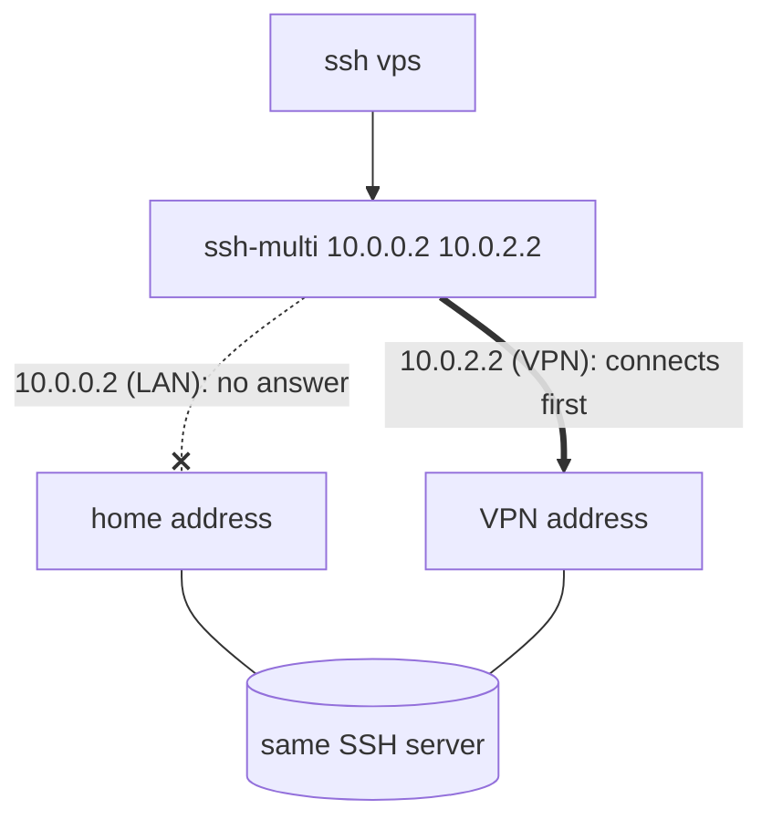

# sshmulti

Use multiple IP/Host addresses to reach the same SSH server. Useful when using
an optional VPN server depending on location ( home vs office )

`ssh-multi` establishes concurrent connections to all specified addresses and
uses whichever connection responds fastest.



## Install

### Quick install (Linux/macOS)

```sh
curl -fsSL https://raw.githubusercontent.com/uintptr/ssh-multi/main/scripts/install.sh | bash
```

Installs the latest release binary to `~/.local/bin`. Linux x86_64, Linux
arm64, and macOS arm64 only.

### From source

```sh
cargo install --git https://github.com/uintptr/ssh-multi
```

## Use

```
Host vps
    ProxyCommand    ssh-multi 10.0.0.2 10.0.2.2
    User            joe
```
